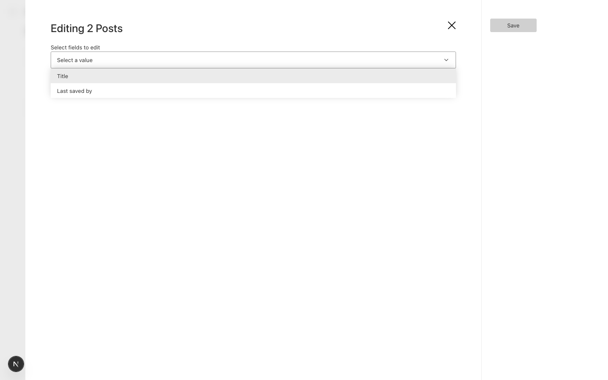
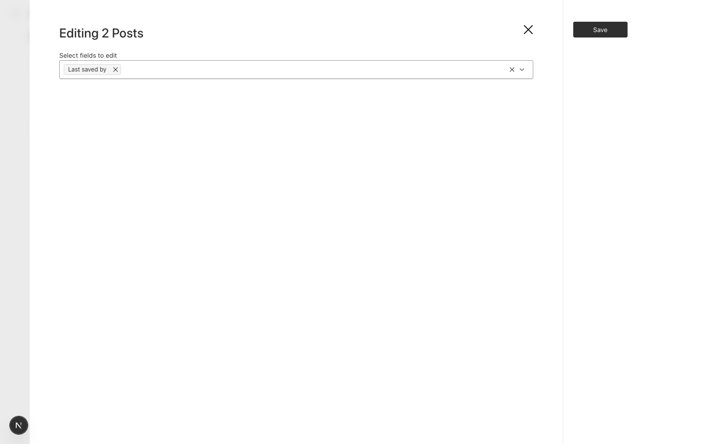

# Bulk edit offers fields marked `admin.hidden`, then renders nothing for them

Payload 3.91.0, Next 16.4.0, Postgres.

## Setup

`src/collections/Posts.ts`: `title`, and `lastSavedBy` (label "Last saved by") with
`admin: { hidden: true }`. In a real app such a field is set by a hook and never edited.

## Steps

1. `pnpm dev`, sign in, create two posts.
2. The edit view shows only Title, as expected.
3. In the Posts list, select all, click Edit, and open "Select fields to edit".

## Expected

Only Title is offered. A field hidden from the admin isn't something an editor can set.

## Actual

"Last saved by" is offered. Selecting it shows no input at all, just an empty drawer
with a Save button.

| Options | After selecting "Last saved by" |
|---|---|
|  |  |

The workaround is `admin.disableBulkEdit: true` on every hidden field.

## Prior art

#16336 "Fields with `admin.condition` are silently hidden in bulk edit" is about the
field selector ignoring `admin.condition`, the same family of problem. `admin.hidden` is
a separate case and isn't mentioned there.
