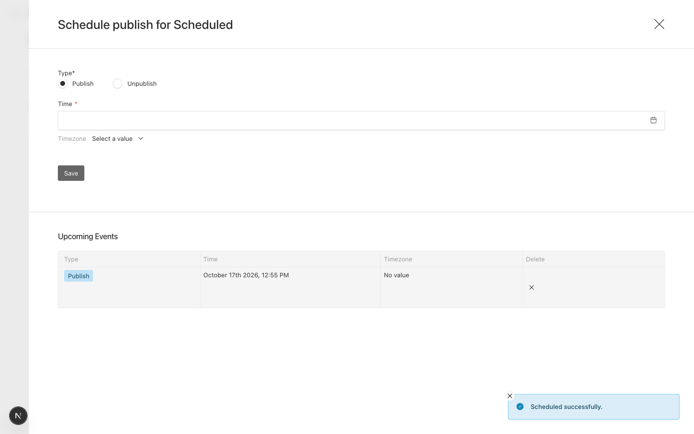
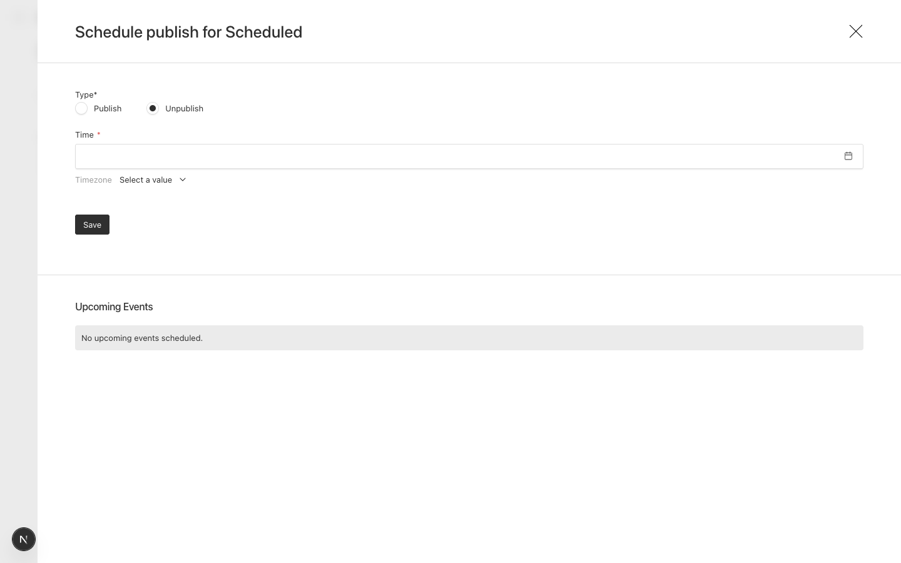

# "Upcoming Events" hides a scheduled publish once its time has passed, even though it hasn't run

Payload 3.91.0, Next 16.4.0, Postgres.

## Setup

`src/collections/Posts.ts`: one text field, `versions: { drafts: { schedulePublish: true } }`.
No job runner (`jobs.autoRun` is unset), so nothing runs the job until something calls
`/api/payload-jobs/run`. That's the same as a deployment whose cron is minutes apart,
late, or broken.

## Steps

1. `pnpm dev`, sign in, create a post, save a draft.
2. Open "Schedule Publish", choose Publish and a time a minute or two ahead, Save.
   The event is listed under Upcoming Events.
3. Wait until that time has passed. Don't run the jobs.
4. Open "Schedule Publish" again.

## Expected

The publish is still listed, because it's still going to happen: it's queued, not
processing, not completed, not failed. The author can see it and can delete it.

## Actual

"No upcoming events scheduled." The job is still in the queue and will publish the
next time jobs run:

```text
 id |    task_slug    |       wait_until       | processing | completed_at | has_error |  now
  1 | schedulePublish | 2026-10-17 01:55:00+00 | f          |              | f         | 2026-10-17 01:55:50+00
```

| Before its time | After its time, not yet run |
|---|---|
|  |  |

So a pending publish is invisible exactly when it's about to happen, and can't be
cancelled from the admin.

`@payloadcms/ui` `dist/elements/PublishButton/ScheduleDrawer/buildUpcomingScheduleWhere.js`
filters on `waitUntil: { greater_than: new Date() }`. Filtering on "not completed and not
failed" would list what is actually still to run.

## Prior art

#15112 "Scheduled Post jobs not showing in Upcoming Events" has the same symptom but a
different cause: an ID type mismatch on SQLite, for jobs still in the future.
