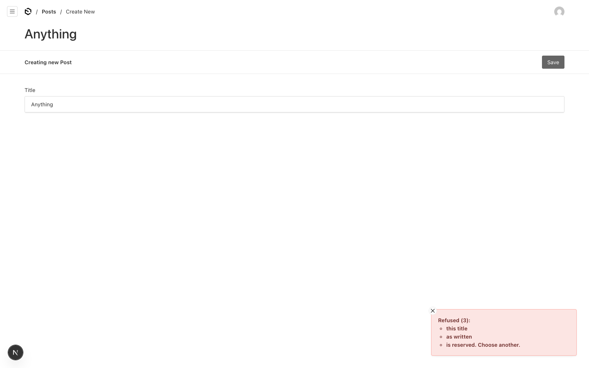

# Error toasts split any message at its first colon and every comma

Payload 3.90.2, Next 16.4.0, Postgres.

## Setup

`src/collections/Posts.ts`: a `beforeChange` hook throws a public `APIError`:

```ts
throw new APIError('Refused: this title, as written, is reserved. Choose another.', 400, undefined, true)
```

## Steps

1. `pnpm dev`, sign in, create a post with any title, Save.

## Expected

The toast shows the message as written.

## Actual

The toast turns it into a count and a list, as if it were a list of invalid fields:

```text
Refused (3):
  • this title
  • as written
  • is reserved. Choose another.
```



`@payloadcms/ui` `dist/elements/Toasts/fieldErrors.js`, `createErrorsFromMessage`, parses
every error message as Payload's own "The following fields are invalid: a, b" format.
Everything before the first `:` becomes the heading, and the rest is split on `,`. Any
custom error message containing a colon followed by a comma is mangled. The only
workaround is to write messages without colons or commas.

The parsing would be safer applied only to `ValidationError` responses, which carry
their field paths in `data.errors`, rather than to every message's text.
