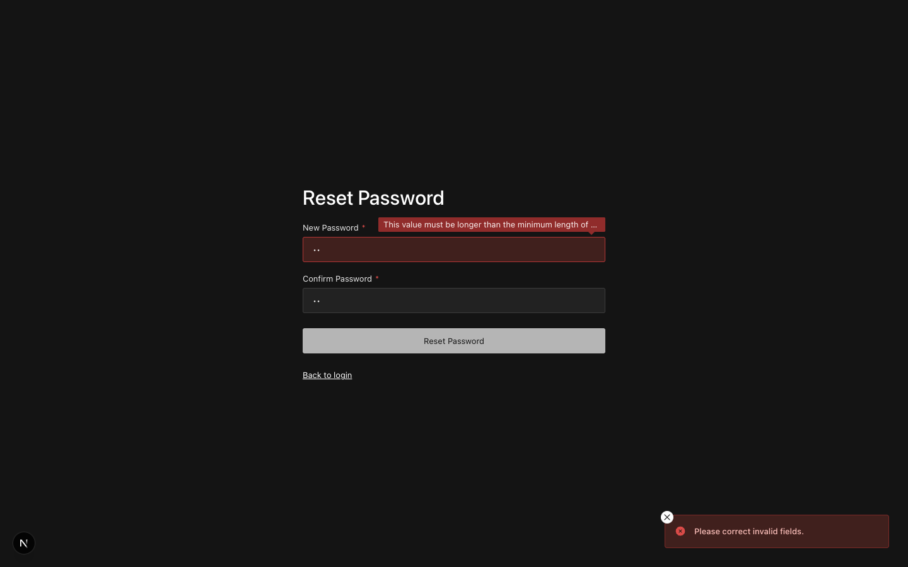

# Field error tooltip truncates the message with an ellipsis

Payload 3.90.2, Next 16.4.0, Postgres, Chrome, 1440x900. The untouched blank template; no
code change.

## Steps

1. `pnpm dev`, open `/admin/reset/anything`. No real token is needed: the browser
   check runs before the token is checked.
2. Enter `ab` in both password fields and press Reset Password.

The create-first-user screen truncates the same message in the same way.

## Expected

The whole message is readable: "This value must be longer than the minimum length of 3
characters."

## Actual

The tooltip is a single line, clipped with an ellipsis at the field's width, so it reads
"This value must be longer than the minimum length of ..." The number the user needs is the
part cut off, because the tooltip doesn't wrap.

Any field error longer than the field is cut off the same way, so custom validation
messages are affected too.

## Prior art

#16774 "Weird Validation error tooltip text clipping" is about descenders (q and g) being
clipped vertically. It's related styling, but not the same problem.
