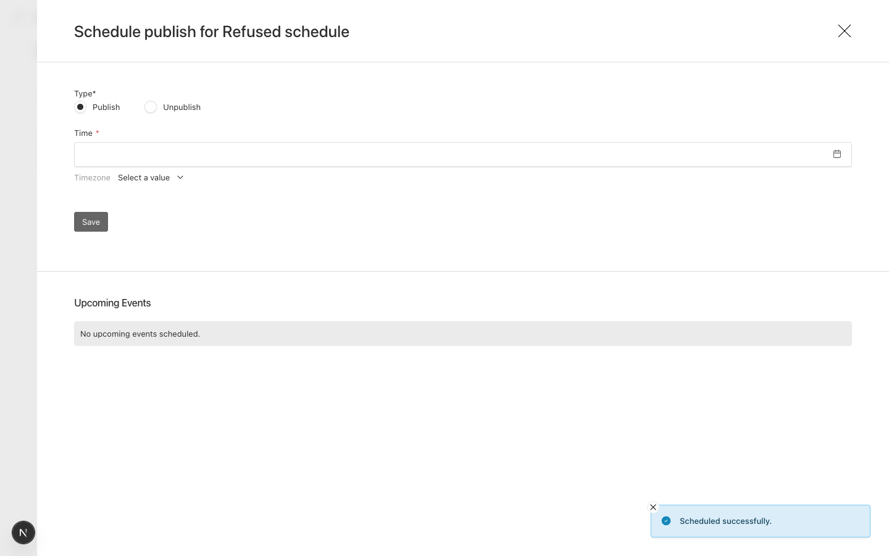

# Schedule drawer says "Scheduled successfully" when scheduling failed

Payload 3.90.2, Next 16.4.0, Postgres.

## Setup

- `src/collections/Posts.ts`: one text field, `versions: { drafts: { schedulePublish: true } }`.
- `src/payload.config.ts`: a `beforeChange` hook on the jobs collection throws a public
  `APIError`, standing in for any server-side failure while a schedule is queued.
  `jobs.runHooks: true` is set only so that `jobs.queue` runs collection hooks at all.

## Steps

1. `pnpm dev`, sign in, create a post, save a draft.
2. Open "Schedule Publish", choose Publish and any future time, Save.

## Expected

An error toast, and no event listed.

## Actual

A green "Scheduled successfully." toast. Nothing was scheduled: the server logged the
failure, no job exists, and Upcoming Events is empty.

```text
ERROR: Error scheduling publish for document with ID 5 in collection posts
    APIError: Scheduling is refused.
```



Payload's own `schedulePublishHandler` (`@payloadcms/ui` `dist/utilities/schedulePublishHandler.js`)
catches the error and **returns** `{ error }`; it doesn't throw. The drawer
(`dist/elements/PublishButton/ScheduleDrawer/index.js`, `handleSave`) awaits
`schedulePublish(...)`, never reads the result, and shows `version:scheduledSuccessfully`
unless the call throws. Deleting a scheduled event (`deleteHandler`) has the same problem,
showing `general:deletedSuccessfully`.

The same applies to any project that overrides the `schedule-publish` server function
and returns `{ error }`, as the stock handler does.
