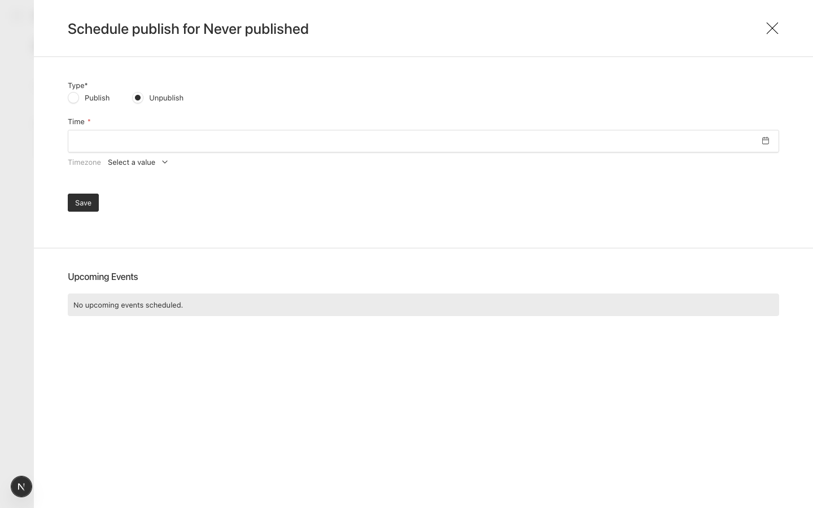

# Schedule drawer defaults to Unpublish on a document that has never been published

Payload 3.91.0, Next 16.4.0, Postgres.

## Setup

`src/collections/Posts.ts`: one text field, `versions: { drafts: { schedulePublish: true } }`.

## Steps

1. `pnpm dev`, sign in.
2. Create a post and save it as a draft. Don't publish it.
3. Open the arrow next to Publish and choose "Schedule Publish".

## Expected

Publish is selected. There's nothing live to unpublish.

## Actual

Unpublish is selected.

`@payloadcms/ui` `dist/elements/PublishButton/index.js` passes
`defaultType: !hasNewerVersions ? 'unpublish' : 'publish'`. A draft that has never been
published has no newer versions than itself, so it gets `'unpublish'`. The default only
looks at whether there are newer versions, not whether the document has ever been
published.
